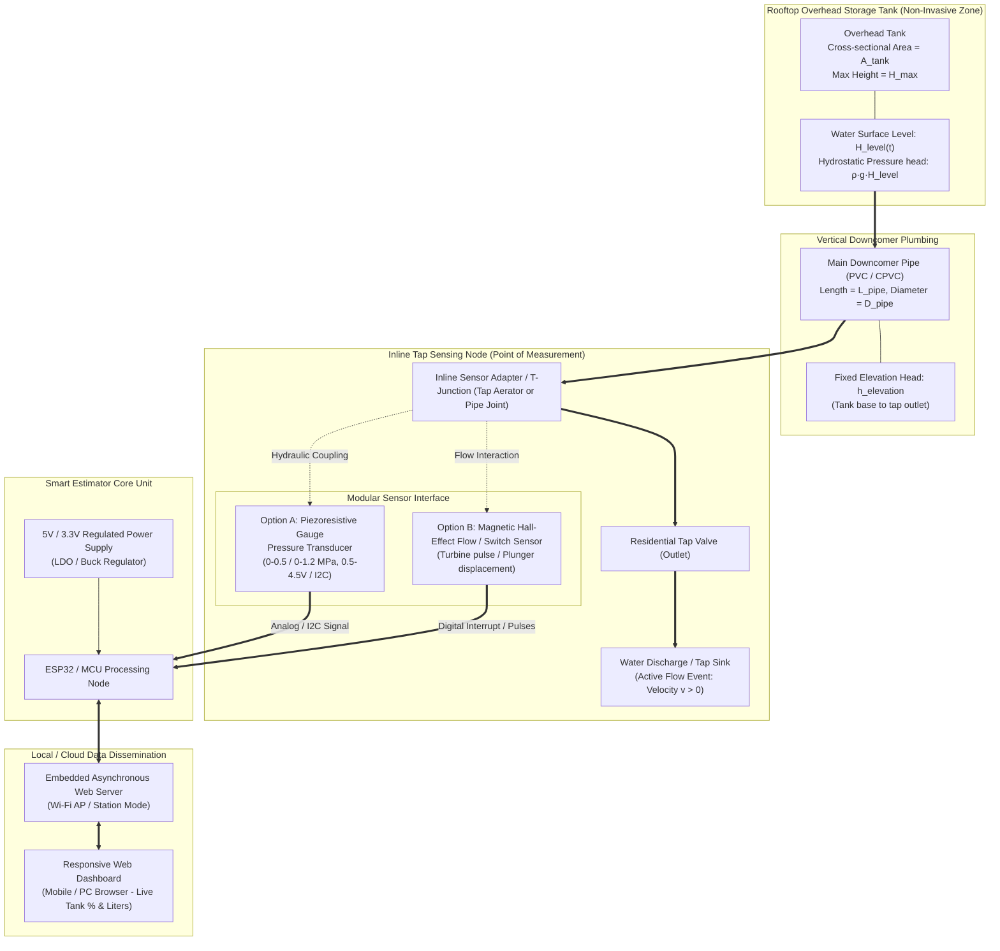
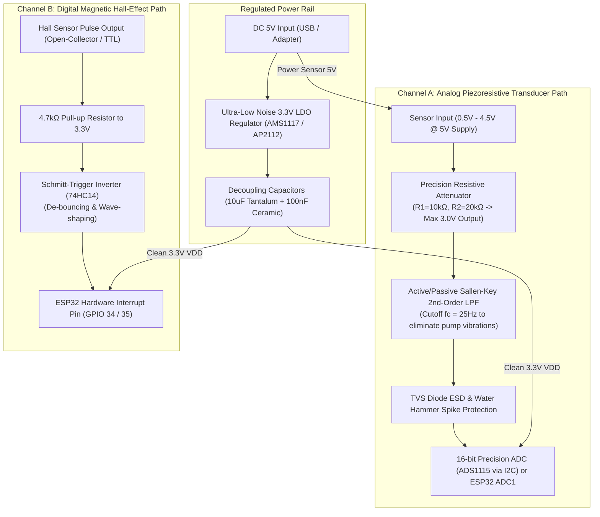
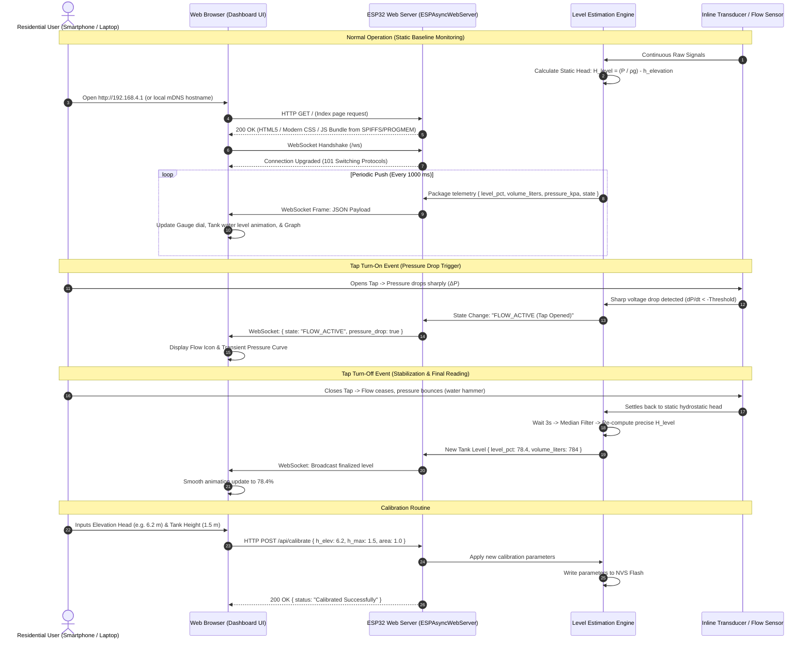

# Dissertation Architecture & Flowcharts: Non-Invasive Inline, Pressure-Drop Activated Smart Residential Tank Water Level Estimation

---

## 1. Physical Hydraulic & Experimental Setup Schematic

The physical setup places the measurement unit **inline at the tap outlet** without modifying or accessing the overhead tank directly.



---

## 2. Complete System Architecture Block Diagram

This reflects the end-to-end hardware and software pipeline: physical fluid interface, signal conditioning, digital processing, estimation algorithms, and communication.

```mermaid
graph LR
    subgraph SENSING_TIER ["1. Physical & Transduction Tier"]
        direction TB
        HP["Hydrostatic + Dynamic Pressure Head in Pipe"]
        P_SENS["Piezoresistive Pressure Sensor\n(Gauge Transducer)"]
        H_SENS["Magnetic Hall-Effect Sensor\n(Turbine / Plunger Pulse)"]
        HP --> P_SENS
        HP --> H_SENS
    end

    subgraph CONDITIONING_TIER ["2. Signal Conditioning Tier"]
        direction TB
        RC_LPF["Analog Low-Pass Filter\n(RC anti-aliasing: fc ~ 50 Hz)"]
        CLAMP["Over-voltage & Surge Protection\n(TVS & Zener Clamping 3.3V)"]
        ADC_EXT["Precision ADC (ADS1115 / ESP32 Internal ADC)\nwith Voltage Divider (5V to 3.3V)"]
        HALL_PULL["Optocoupler / Schmitt Trigger Buffer\n+ Pull-up Resistor"]
        
        P_SENS --> CLAMP --> RC_LPF --> ADC_EXT
        H_SENS --> HALL_PULL
    end

    subgraph PROCESSING_TIER ["3. Embedded Edge Compute (ESP32)"]
        direction TB
        ISR["Event Interrupt Service Routine\n(Pressure Drop / Pulse Trigger)"]
        DIG_FILT["Digital Filtering Engine\n(Exponential Moving Average / Median Filter)"]
        HAMMER_REJ["Water Hammer & Surge Rejection Logic"]
        STATE_ENG["Operating State Machine\n(IDLE, DROP_DETECT, FLOWING, SETTLING, ESTIMATING)"]
        CALIB_ENG["Calibration & Geometry Engine\n(h_elevation, Tank Area, ρ, g)"]
        MATH_MODEL["Hydrostatic Level Formulation\nH_level = (P_static / ρg) - h_elevation"]
        
        ADC_EXT --> DIG_FILT
        HALL_PULL --> ISR
        DIG_FILT --> ISR
        ISR --> STATE_ENG
        DIG_FILT --> HAMMER_REJ --> STATE_ENG
        STATE_ENG --> CALIB_ENG --> MATH_MODEL
    end

    subgraph CONNECTIVITY_TIER ["4. Web Server & Storage Tier"]
        direction TB
        NVS["Non-Volatile Storage (EEPROM / SPIFFS)\n(Calibration Offsets & History)"]
        WEB_SRV["ESPAsyncWebServer / WebSocket Engine\n(Port 80)"]
        REST_API["RESTful Endpoints\n(/api/level, /api/pressure, /api/calibrate)"]
        
        MATH_MODEL --> WEB_SRV
        CALIB_ENG <--> NVS
        WEB_SRV --- REST_API
    end

    subgraph CLIENT_TIER ["5. User Presentation Tier"]
        direction TB
        UI["Web Dashboard (Chart.js / SVG Tank Visualization)"]
        ALERT["Audible / Visual Low Water Level Alarm"]
        REST_API ==> UI
        REST_API ==> ALERT
    end
```



---

## 3. Modular Signal Conditioning Block Diagram

Designed to accommodate **either** a Pressure Sensor or a Magnetic Hall Sensor (or both) without PCB redesign.



---

## 4. Firmware State Machine Flowchart

This state machine controls the operation of the device: handling static baseline tracking, triggering upon pressure drops when a tap opens, waiting out dynamic turbulence, and sampling the stable post-event hydrostatic head.

```mermaid
stateDiagram-v2
    [*] --> STATE_INIT : Power On / Reset

    state STATE_INIT {
        [*] --> LoadCalibration : Read h_elevation & H_max from NVS
        LoadCalibration --> InitSensors : Init ADC / Attach Hall Interrupt
        InitSensors --> StartWebServer : Start AP / Station & Web Server
    }

    STATE_INIT --> STATE_STATIC_MONITOR : Initialization Complete

    state STATE_STATIC_MONITOR {
        [*] --> ReadStaticBaseline : Sample P_static at 10Hz
        ReadStaticBaseline --> SmoothData : Apply EMA Filter
        SmoothData --> CheckDropThreshold : Calculate dP/dt
    }

    STATE_STATIC_MONITOR --> STATE_FLOW_DETECTED : dP/dt < -Threshold OR Hall Pulses > 0
    STATE_STATIC_MONITOR --> STATE_ESTIMATE : Periodic Interval (e.g. Every 15 min)

    state STATE_FLOW_DETECTED {
        [*] --> LogEventTimestamp : Tap Open Detected
        LogEventTimestamp --> DynamicSampling : Track dynamic pressure drop & flow duration
        DynamicSampling --> CheckFlowStop : Has dP/dt stabilized OR Hall Pulses stopped?
    }

    STATE_FLOW_DETECTED --> STATE_SETTLING : Flow Ceased (Tap Closed)

    state STATE_SETTLING {
        [*] --> HammerDelay : Wait T_settle (2 to 5 seconds)
        HammerDelay --> RejectOscillations : Rebound/Water hammer peak rejection
    }

    STATE_SETTLING --> STATE_ESTIMATE : Pressure Waveform Settled

    state STATE_ESTIMATE {
        [*] --> SampleEquilibrium : Measure 50 samples of P_static
        SampleEquilibrium --> RemoveOutliers : Median Filter
        RemoveOutliers --> ComputeLevel : H = (P_static / ρg) - h_elevation
        ComputeLevel --> BoundCheck : Constrain [0 <= H <= H_max]
        BoundCheck --> CalculateVolume : Vol = Area * H
        CalculateVolume --> BroadcastWeb : Push JSON over WebSocket & Update REST
    }

    STATE_ESTIMATE --> STATE_STATIC_MONITOR : Return to Monitoring
```



---

## 5. Hydrostatic Level Estimation & Signal Processing Algorithm Flowchart

Step-by-step logic showing how raw sensor voltage is converted into a calibrated water level in percentage and liters.

```mermaid
flowchart TD
    START([Start Loop]) --> RAW_ACQ[Acquire Raw Sensor Value]
    
    RAW_ACQ --> MOD_CHECK{Sensor Mode?}
    
    MOD_CHECK -- Pressure Transducer --> CONV_V[Convert ADC counts to Voltage V_out]
    CONV_V --> CONV_P[Convert V_out to Gauge Pressure P_gauge in kPa\nP_gauge = (V_out - V_offset) * Sensitivity]
    CONV_P --> EMA[Apply Exponential Moving Average:\nP_filt = α * P_gauge + (1-α) * P_prev]
    
    EMA --> DERIV[Calculate Rate of Change: dP/dt = (P_filt - P_last) / Δt]
    
    DERIV --> IS_DROP{dP/dt < -Threshold_Drop?}
    IS_DROP -- Yes (Tap Opened) --> FLAG_FLOW[Set Flowing Flag = TRUE\nRecord pre-flow pressure P_pre]
    IS_DROP -- No --> CHECK_RECOVER{Flowing Flag is TRUE\nAND\ndP/dt > +Threshold_Recovery?}
    
    CHECK_RECOVER -- Yes (Tap Closed) --> WAIT_HAMMER[Execute Non-Blocking Settling Delay\nT_delay = 3.0 sec\n(Suppress Water Hammer Oscillations)]
    WAIT_HAMMER --> FLAG_STATIC[Set Flowing Flag = FALSE]
    
    CHECK_RECOVER -- No --> PASS_TO_CALC[Continue]
    FLAG_FLOW --> PASS_TO_CALC
    FLAG_STATIC --> MULTI_SAMPLE[Take N=32 Over-sampled Readings of P_filt]
    
    MULTI_SAMPLE --> MEDIAN_FILT[Apply Median Filter to eliminate outlier spikes]
    MEDIAN_FILT --> HEAD_CALC["Calculate Equivalent Water Head:\nH_total = (P_median * 1000) / (ρ * g)  [meters]"]
    
    HEAD_CALC --> SUB_ELEV["Deduct Elevation Head:\nH_level = H_total - h_elevation  [meters]"]
    
    SUB_ELEV --> CLAMP_HEAD{"H_level < 0 ?"}
    CLAMP_HEAD -- Yes --> ZERO_HEAD[H_level = 0.0 m]
    CLAMP_HEAD -- No --> CLAMP_MAX{"H_level > H_max ?"}
    CLAMP_MAX -- Yes --> MAX_HEAD[H_level = H_max]
    CLAMP_MAX -- No --> PERCENT_CALC[Level_Percentage = (H_level / H_max) * 100 %]
    ZERO_HEAD --> PERCENT_CALC
    MAX_HEAD --> PERCENT_CALC
    
    PERCENT_CALC --> VOL_CALC["Volume_Liters = (A_tank * H_level) * 1000"]
    VOL_CALC --> UPDATE_STRUCT[Update Data Structure & WebSocket Clients]
    UPDATE_STRUCT --> SLEEP_OR_YIELD([Yield to FreeRTOS Task / Loop])
    PASS_TO_CALC --> SLEEP_OR_YIELD

    MOD_CHECK -- Magnetic Hall Flow --> PULSE_COUNT[Count Interrupt Pulses in window Δt]
    PULSE_COUNT --> CALC_FLOW[Flow Rate Q = Pulses / Calibration_Factor]
    CALC_FLOW --> FLOW_CHECK{Q > 0 ?}
    FLOW_CHECK -- Yes --> EST_CONSUMPTION[Integrate Volume Consumed: Vol_used += Q * Δt]
    EST_CONSUMPTION --> LEVEL_DEDUCE[Deduce Residual Level: H = H_start - (Vol_used / A_tank)]
    FLOW_CHECK -- No --> PASS_TO_CALC
    LEVEL_DEDUCE --> UPDATE_STRUCT
```

---

## 6. Embedded Web Server & Client Data Flow


