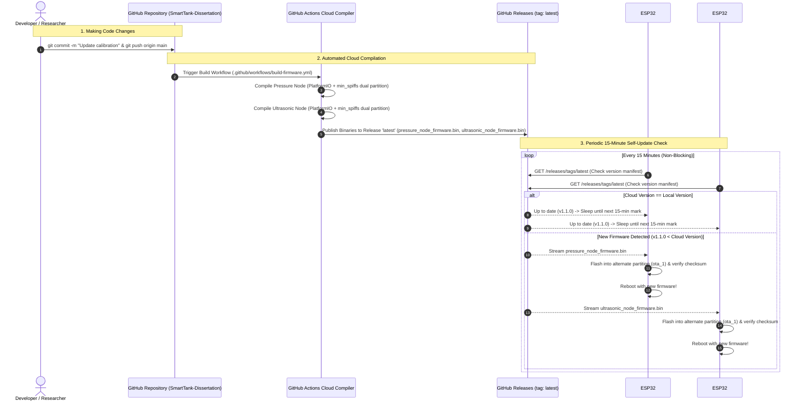

# Automated Cloud OTA (Over-The-Air) 15-Minute Self-Update Guide

This document describes the automated cloud deployment architecture for the **Smart Tank Dissertation Monitoring System**. Both ESP32 nodes autonomously poll the GitHub cloud repository every **15 minutes**, detect new compiled binary releases, and re-flash themselves over-the-air without physical USB or manual intervention.

---

## 1. System Architecture & Update Flow



---

## 2. Partition Scheme & Fail-Safe Protection

Both nodes are configured in `platformio.ini` with:
```ini
board_build.partitions = min_spiffs.csv
```

### Partition Table Layout (4MB Flash):
| Partition | Type | SubType | Flash Offset | Size | Purpose |
| :--- | :--- | :--- | :--- | :--- | :--- |
| **`nvs`** | Data | NVS | `0x09000` | 20 KB | WiFi, Calibrated empty/full kPa, GitHub Token |
| **`otadata`** | Data | OTA | `0x0E000` | 8 KB | Active boot slot selector |
| **`app0`** | App | `ota_0` | `0x10000` | **1.92 MB** | Primary firmware slot |
| **`app1`** | App | `ota_1` | `0x1F000` | **1.92 MB** | Secondary firmware slot (downloads flash here) |
| **`spiffs`** | Data | SPIFFS | `0x3D000` | 192 KB | Power-fail-safe offline queue storage |

> [!TIP]
> **Anti-Brick Guarantee**: If power fails or internet drops in the middle of a 15-minute download, the ESP32 simply reverts to its existing active partition on boot. The running firmware is never touched until the download has completed and verified 100%.

---

## 3. How to Deploy Code Updates in 3 Simple Steps

### Step 1: Make your changes in code
For example, tweak a calibration threshold or sensor parameter in `firmware/esp32_pressure_tap_node/config.h`.

### Step 2: Bump the version number
In `firmware/version.json`:
```json
{
  "firmware_version": "1.2.0",
  ...
}
```
And in `config.h`:
```cpp
#define FIRMWARE_VERSION "1.2.0"
```

### Step 3: Commit and Push to GitHub
```bash
git add .
git commit -m "Calibrated sensor thresholds v1.2.0"
git push origin main
```

**That's it!** GitHub Actions will automatically:
1. Build both `.bin` binaries on Ubuntu runners.
2. Update the `latest` GitHub Release.
3. Within 15 minutes, both ESP32s will autonomously download and apply the update.

---

## 4. Private Repository Token Setup

Because `SubhraJyotiDey/SmartTank-Dissertation` is a private repository, GitHub requires an authenticated token to read release assets.

You can configure your token in **either** of two ways:

### Option A: Via the Web Dashboard (Recommended - Zero Code Touch)
1. Open the ESP32 Web Dashboard on your phone or laptop:
   `http://192.168.x.x` (or `http://esp32-tap-pressure.local`)
2. Scroll to the **Cloud Over-The-Air (OTA) Self-Updater** card.
3. Paste your GitHub Personal Access Token (`ghp_...` or fine-grained token with `contents:read` scope).
4. Click **Save Token**. It is stored safely in Flash NVS and never pushed to Git.
5. Click **Check Updates Now** to trigger an immediate test update!

### Option B: Make the Repository Public
If you set the GitHub repository to **Public**:
- **Zero tokens required**: The ESP32s can download `pressure_node_firmware.bin` and `ultrasonic_node_firmware.bin` directly without any headers or authentication.

---

## 5. Serial Monitor Output Example

Every 15 minutes, you will see this non-blocking cycle in the Serial monitor:

```text
[AUTO-OTA] 15-minute periodic update check interval reached (v1.1.0)...
[AUTO-OTA] Contacting GitHub (SubhraJyotiDey/SmartTank-Dissertation) for release: latest
[AUTO-OTA] GitHub Version Manifest parsed: latest v1.1.0 (Current: v1.1.0)
[AUTO-OTA] ✅ System is up to date (Running v1.1.0). Next check in 15 mins.
```

When a new update is pushed:
```text
[AUTO-OTA] 🚀 New firmware detected! Local: v1.1.0 -> Cloud: v1.2.0
[AUTO-OTA] Downloading binary from: https://api.github.com/...
[AUTO-OTA] Firmware binary size: 1417371 bytes (1.35 MB)
[AUTO-OTA] Flashing firmware to secondary partition...
[AUTO-OTA] Progress: 15% (212605 / 1417371 bytes)
[AUTO-OTA] Progress: 30% (425211 / 1417371 bytes)
[AUTO-OTA] Progress: 45% (637816 / 1417371 bytes)
[AUTO-OTA] Progress: 60% (850422 / 1417371 bytes)
[AUTO-OTA] Progress: 75% (1063028 / 1417371 bytes)
[AUTO-OTA] Progress: 90% (1275633 / 1417371 bytes)
[AUTO-OTA] Progress: 100% (1417371 / 1417371 bytes)

===========================================================
 [AUTO-OTA] ✨ FIRMWARE UPDATE SUCCESSFUL!
 Written: 1417371 bytes. System will reboot in 2 seconds...
===========================================================
```
