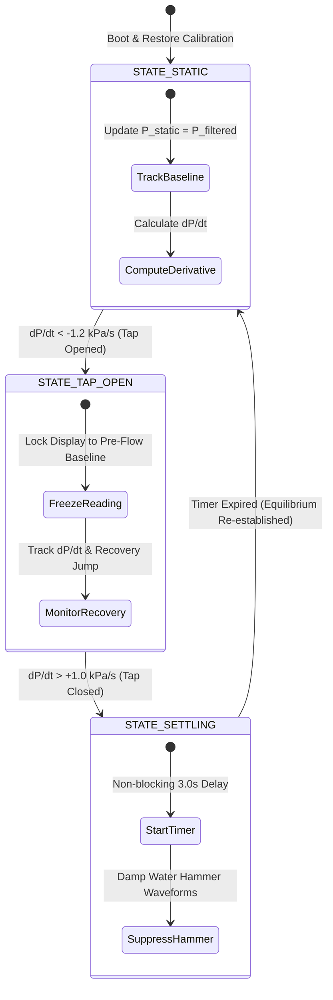

# Hydrodynamic Theory & Pressure Drop Compensation Algorithm

This document outlines the scientific and hydraulic foundation for estimating overhead tank water levels from an inline tap sensor, including dynamic flow compensation and two-point calibration.

---

## 1. Physical Principle & Governing Hydraulic Equations

### 1.1 Static Equilibrium (Tap Closed)
When all residential taps are closed, the water column is in hydrostatic equilibrium. The gauge pressure $P_{\text{static}}$ measured at the tap head is given by:

$$P_{\text{static}} = \rho g \left( h_{\text{elevation}} + H_{\text{water}}(t) \right)$$

Where:
* $\rho$ = Density of water ($1000 \text{ kg/m}^3$)
* $g$ = Gravitational acceleration ($9.80665 \text{ m/s}^2$)
* $h_{\text{elevation}}$ = Fixed vertical distance from the tap outlet to the base of the overhead tank
* $H_{\text{water}}(t)$ = Dynamic water depth inside the overhead storage tank

### 1.2 Dynamic Flow Condition (Tap Open)
Applying Bernoulli's Energy Conservation principle between the overhead tank surface (Point 1) and the tap outlet (Point 2):

$$P_1 + \frac{1}{2}\rho v_1^2 + \rho g z_1 = P_2 + \frac{1}{2}\rho v_2^2 + \rho g z_2 + \Delta P_{\text{loss}}$$

Since the tank surface area is substantially larger than the pipe ($A_{\text{tank}} \gg A_{\text{pipe}}$), $v_1 \approx 0$. At the tap discharge:

$$P_{\text{tap}}(t) = P_{\text{static}} - \underbrace{\frac{1}{2} \rho v_{\text{pipe}}^2}_{\text{Dynamic Kinetic Energy}} - \underbrace{\rho g \left( f \frac{L}{D} \frac{v_{\text{pipe}}^2}{2g} + \sum K \frac{v_{\text{pipe}}^2}{2g} \right)}_{\text{Darcy-Weisbach & Minor Fitting Losses}}$$

$$P_{\text{tap}}(t) = P_{\text{static}} - \Delta P_{\text{dynamic}}(t)$$

### 1.3 The Problem Solved by Dynamic Compensation
When an occupant opens a tap, the measured pressure plummets rapidly due to fluid velocity and pipe friction. 
* **Without Compensation:** A naive pressure sensor interprets this sudden $\Delta P_{\text{dynamic}}$ drop as the rooftop tank running dry, causing false empty alerts.
* **With Our Firmware State Machine:** The microcontroller continuously computes the first derivative $\frac{dP}{dt}$. When $\frac{dP}{dt} < -\text{Threshold}$, the firmware flags an active flow event, freezes the estimated level at the pre-flow static baseline, and suppresses transient errors until the tap closes.

---

## 2. Firmware Operating State Machine



### 2.1 State Descriptions
1. **`STATE_STATIC` (Normal Equilibrium):**
   * Continuous oversampling (40 samples per cycle) + Exponential Moving Average (EMA, $\alpha = 0.15$).
   * Water level is evaluated in real time from the filtered pressure.
   * Derivative $\frac{dP}{dt}$ is computed every $100\text{ ms}$.

2. **`STATE_TAP_OPEN` (Dynamic Discharge Detected):**
   * Triggered when $\frac{dP}{dt} < -1.2 \text{ kPa/s}$.
   * The displayed water level is **frozen** at the last confirmed static baseline $P_{\text{last\_static}}$.
   * Prevents false drain warnings during tap usage.

3. **`STATE_SETTLING` (Water Hammer & Oscillation Rejection):**
   * Triggered when the tap closes and pressure rises sharply ($\frac{dP}{dt} > +1.0 \text{ kPa/s}$).
   * In residential plumbing, sudden valve closure triggers high-frequency hydraulic shockwaves (water hammer) that oscillate for $1.5 \text{ to } 2.5 \text{ seconds}$.
   * The firmware executes a **3.0-second settling delay**, rejecting transient pressure spikes before updating the baseline.

---

## 3. Mathematical Proof of Two-Point Calibration

Traditional methods require measuring the pipe riser height $h_{\text{elevation}}$ with a tape measure or laser meter, which is difficult in multi-story buildings.

Our two-point calibration system completely eliminates the need for geometric elevation measurements:

### Step 1: Calibration at Tank Empty ($H_{\text{water}} = 0$)
$$P_{\text{empty}} = \rho g h_{\text{elevation}}$$

### Step 2: Calibration at Tank Full ($H_{\text{water}} = H_{\text{max}}$)
$$P_{\text{full}} = \rho g \left( h_{\text{elevation}} + H_{\text{max}} \right)$$

### Step 3: Subtraction & Linear Mapping
Subtracting the two equations:
$$P_{\text{full}} - P_{\text{empty}} = \rho g H_{\text{max}}$$

For any instantaneous static pressure $P(t)$:
$$P(t) - P_{\text{empty}} = \rho g H_{\text{water}}(t)$$

Dividing the two yields the exact level percentage:
$$\mathbf{\text{Level}_{\%} = \frac{P(t) - P_{\text{empty}}}{P_{\text{full}} - P_{\text{empty}}} \times 100\%}$$

$$\mathbf{H_{\text{water}}(t) = \left( \frac{\text{Level}_{\%}}{100} \right) \times H_{\text{max}}}$$

**Conclusion:** The fixed elevation head $h_{\text{elevation}}$ drops out of the equation completely! Both temperature drift and elevation offsets are naturally normalized by the two-point calibration.

---

## 4. Google Sheets Synchronized Logging Architecture

```text
       ESP32 Node 1 (Tap Head)                   ESP32 Node 2 (Overhead Tank)
       [ 0.2 MPa Pressure Sensor ]               [ Ultrasonic Ground Truth ]
                    |                                         |
     NTP Synchronized (e.g. 14:10:00)           NTP Synchronized (e.g. 14:10:00)
                    |                                         |
         HTTPS GET (node=pressure)                 HTTPS GET (node=ultrasonic)
                    |                                         |
                    +--------------------+--------------------+
                                         |
                                         v
                         Google Apps Script Web App
                                         |
                   +---------------------+---------------------+
                   | Round timestamp to 10-Min Bucket Slot:     |
                   | Bucket Key = "2026-10-24 14:10:00"        |
                   +---------------------+---------------------+
                                         |
              +--------------------------+--------------------------+
              |                                                     |
    [Row Does Not Exist Yet]                                [Row Already Exists]
              |                                                     |
    Create new row with Slot                              Update respective columns
              \                                                     /
               +-------------------------+-------------------------+
                                         |
                                         v
                     Compute Ground Reality Delta:
                     Col I: |Pressure% - Ultrasonic%| (%)
                     Col J: Error in Depth (cm)
```
